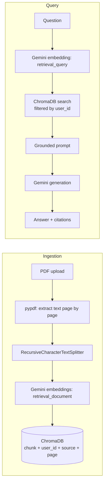

# Enterprise RAG Engine

Multi-tenant document question answering built with **FastAPI**, **Google Gemini**, and **ChromaDB**. Users register, upload PDFs into their own private space, and ask questions. Answers are generated **only from their own documents**, with page-level citations, and the system refuses to answer when the documents don't contain the information.

## Features

- **Grounded answers with citations**: every answer cites the source file and page. A strict prompt forbids outside knowledge.
- **Trustworthy refusal**: if the retrieved context doesn't answer the question, the engine says so (and returns no sources) instead of hallucinating.
- **Page-aware ingestion**: PDFs are extracted page by page, so every chunk keeps its page number as metadata.
- **Asymmetric embeddings**: documents are embedded with Gemini's `retrieval_document` task type and questions with `retrieval_query`, which improves retrieval quality.
- **Persistent vector storage**: ChromaDB runs on disk, so embeddings survive restarts.
- **Authentication**: register/login with bcrypt-hashed passwords and signed JWT access tokens.
- **Per-user data isolation**: every chunk is stamped with its owner's `user_id`, and every search is filtered by it. One user can never retrieve another user's documents.
- **Fail-fast configuration**: typed settings (Pydantic) crash at startup if a required secret is missing, instead of failing mid-request.
- **Interactive API docs** at `/docs` (Swagger UI), including an **Authorize** button for the login flow.

## Architecture



**Auth flow:** `POST /register` → `POST /login` (returns a JWT) → send `Authorization: Bearer <token>` on protected routes. The user's identity always comes from the **verified token**, never from request data, so a client cannot claim to be someone else.

## Tech Stack

| Layer | Technology |
|---|---|
| Backend | FastAPI, Pydantic v2, Uvicorn |
| Document processing | `pypdf`, `langchain-text-splitters` (`RecursiveCharacterTextSplitter`) |
| Embeddings | Google Gemini `models/gemini-embedding-001` (3072 dimensions) |
| Vector database | ChromaDB (`PersistentClient`, local disk) |
| Generation | Google Gemini (configurable via `GENERATION_MODEL_NAME`) |
| Users database | SQLAlchemy + SQLite |
| Auth | `passlib` (bcrypt), `python-jose` (JWT) |
| Config | `pydantic-settings`, `python-dotenv` |

## Project Structure

```
Enterprise-RAG-Engine/
├── core/
│   ├── __init__.py
│   ├── config.py              # Typed settings loaded from .env
│   ├── embedding_function.py  # Gemini embeddings for ChromaDB (+ query embedding)
│   ├── document_loader.py     # Page-aware PDF loader and text splitter
│   ├── vector_store.py        # ChromaDB collection manager (user-scoped)
│   ├── rag_chain.py           # Grounded prompt + retrieval + generation
│   ├── database.py            # SQLAlchemy engine and session
│   ├── models.py              # User table
│   └── auth.py                # Password hashing, JWT, get_current_user
├── main.py                    # FastAPI app and routes
├── requirements.txt
└── README.md

# Created at runtime (git-ignored): data/, vector_db/, users.db, .env
```

## Getting Started

### Prerequisites

- **Python 3.11 or 3.12** (newer versions may lack prebuilt wheels for ChromaDB's dependencies on Windows)
- A Google Gemini API key from [Google AI Studio](https://aistudio.google.com/apikey)

### Installation

```bash
git clone https://github.com/UmarMujahid07/Enterprise-RAG-Engine.git
cd Enterprise-RAG-Engine

python -m venv venv
# Windows (PowerShell):  venv\Scripts\activate
# macOS / Linux:         source venv/bin/activate

pip install -r requirements.txt
```

### Configuration

Create a `.env` file in the project root (no quotes, no spaces around `=`):

```env
GOOGLE_API_KEY=your_gemini_api_key
SECRET_KEY=your_random_secret
```

Generate a strong `SECRET_KEY`:

```bash
python -c "import secrets; print(secrets.token_hex(32))"
```

Optional overrides (defaults live in `core/config.py`):

| Variable | Default | Purpose |
|---|---|---|
| `GENERATION_MODEL_NAME` | set in `config.py` | Gemini model used for answers |
| `EMBEDDING_MODEL_NAME` | `models/gemini-embedding-001` | Embedding model |
| `CHUNK_SIZE` / `CHUNK_OVERLAP` | `1000` / `150` | Text splitting (characters) |
| `TOP_K_RESULTS` | `4` | Chunks retrieved per question |
| `ACCESS_TOKEN_EXPIRE_MINUTES` | `60` | JWT lifetime |
| `DATABASE_URL` | `sqlite:///./users.db` | Users database |
| `COLLECTION_NAME` | `enterprise_rag_collection` | ChromaDB collection |

### Run

```bash
uvicorn main:app --reload
```

Open **http://127.0.0.1:8000/docs**.

## Usage

### In the browser (Swagger UI)

1. `POST /register` with an email and a password (8 to 72 characters).
2. Click **Authorize**, enter your **email as the username** plus your password, and confirm.
3. `POST /upload-pdf` and choose a PDF.
4. `POST /query` with `{"question": "What is this lecture about?"}`.

### With curl

```bash
# Register
curl -X POST http://127.0.0.1:8000/register \
  -H "Content-Type: application/json" \
  -d '{"email":"you@example.com","password":"strongpass123"}'

# Login (OAuth2 form: "username" carries the email)
curl -X POST http://127.0.0.1:8000/login \
  -d "username=you@example.com&password=strongpass123"
# -> {"access_token":"eyJ...","token_type":"bearer"}

TOKEN="paste_access_token_here"

# Upload a PDF
curl -X POST http://127.0.0.1:8000/upload-pdf \
  -H "Authorization: Bearer $TOKEN" \
  -F "file=@lecture.pdf"

# Ask a question
curl -X POST http://127.0.0.1:8000/query \
  -H "Authorization: Bearer $TOKEN" \
  -H "Content-Type: application/json" \
  -d '{"question":"What is this lecture about?"}'
```

Illustrative response shape:

```json
{
  "answer": "This lecture is an introduction to the Design & Analysis of Algorithms. (Source: lecture.pdf, Page 1)",
  "sources": [
    { "source": "lecture.pdf", "page": 1 },
    { "source": "lecture.pdf", "page": 2 }
  ]
}
```

When the documents don't contain the answer:

```json
{
  "answer": "I don't have enough information in the provided documents to answer this.",
  "sources": []
}
```

## API Reference

| Method | Endpoint | Auth | Description |
|---|---|---|---|
| `POST` | `/register` | Public | Create an account (email format and password length validated, email stored lowercase) |
| `POST` | `/login` | Public | OAuth2 password form; returns a JWT access token |
| `GET` | `/health` | Public | Liveness check |
| `GET` | `/me` | Bearer token | Returns the logged-in user |
| `POST` | `/upload-pdf` | Bearer token | Ingest a PDF into **your** private document space |
| `POST` | `/query` | Bearer token | Ask a question over **your** documents only |

Error codes you will see: `400` bad input (non-PDF, empty question, duplicate email), `401` missing or invalid token / wrong credentials, `422` validation errors or a PDF with no extractable text.

## Design Decisions

- **Page-by-page extraction.** Concatenating a whole PDF before chunking would erase page boundaries and make accurate citations impossible.
- **Recursive splitting with overlap.** Splits on paragraphs, then sentences, then words, so chunks stay semantically coherent. Overlap preserves context across chunk boundaries.
- **Custom embedding class for ChromaDB.** Keeps ingestion and retrieval in the same vector space (Gemini), instead of silently falling back to ChromaDB's default local model.
- **Separate query embedding.** Questions bypass `query_texts` and are embedded with the `retrieval_query` task type, then searched via `query_embeddings`.
- **Strict grounding prompt and refusal path.** For document QA, a confident wrong answer is worse than "I don't know". Sources are suppressed on refusal because the retrieved chunks weren't actually used.
- **Isolation at the query layer.** A single ChromaDB collection with a `user_id` metadata filter applied before similarity ranking. `user_id` is a required argument of every search, so a missing filter is impossible by construction. Chunk IDs are prefixed with the user id so two users uploading the same filename can't overwrite each other.
- **Stateless auth.** JWTs are signed with `SECRET_KEY` and verified on every request with no server-side session store. The token holds only the email; the user record is re-fetched from the database each time.

## Security Notes

- Passwords are stored only as **bcrypt** hashes (slow by design, salted).
- Login returns the same generic error for "unknown email" and "wrong password" to prevent account enumeration.
- Secrets (`GOOGLE_API_KEY`, `SECRET_KEY`) live in `.env`, which is git-ignored. Settings validation fails at startup if they are missing.
- Uploaded filenames are stripped of directory components and prefixed with a UUID before being written to disk.
- Internal fields such as `user_id` are never returned in API responses.

## Troubleshooting

| Problem | Fix |
|---|---|
| `Could not find a version ... chroma-hnswlib` / "Microsoft Visual C++ 14.0 required" | Use Python 3.11 or 3.12 for the virtual environment |
| `DLL load failed while importing chromadb_rust_bindings` (Windows) | Install the Microsoft Visual C++ Redistributable (x64), then restart the terminal |
| `module 'bcrypt' has no attribute '__about__'` or "password cannot be longer than 72 bytes" | Pin `bcrypt==4.0.1` (compatibility with `passlib 1.7.4`) |
| `models/... is not found for API version v1beta` (404) | Google retires model names. Set a current model in `GENERATION_MODEL_NAME` |
| `API key not valid` | Check `.env`: no quotes, no stray characters or spaces, key copied completely |
| PowerShell: "running scripts is disabled" on venv activation | `Set-ExecutionPolicy -Scope CurrentUser -ExecutionPolicy RemoteSigned` |
| `ModuleNotFoundError: No module named 'core'` | Run commands from the project root, not from inside `core/` (and not via an editor's Run button on files in `core/`) |

## Limitations and Roadmap

Known limitations of the current version:

- **PDF only.** The loader is isolated in `document_loader.py` so more formats (DOCX, TXT) can be added as sibling loaders. No OCR for scanned PDFs.
- **No upload limits or rate limiting yet.** No file-size, page, or per-user quota, and no throttling on login or query.
- **No document management.** There are no endpoints to list or delete uploaded documents, and citations show the stored filename (including a UUID prefix).
- **Synchronous AI calls inside async routes**, and embeddings are requested one chunk at a time. Large documents are slow. Batch embedding and a threadpool or background jobs would fix this.
- **Deprecated SDK.** `google-generativeai` is end-of-life; migrating to `google-genai` is planned.
- **Single-instance storage.** SQLite and local-disk ChromaDB suit one server. Scaling out would mean Postgres and a managed vector database, or per-tenant collections for stronger isolation.
- **Auth is minimal.** No token refresh or revocation, email verification, or password reset.
- **No automated tests or CI.** Verification so far has been manual: per-module checks, a refusal test with out-of-scope questions, and a two-user isolation test.

Planned next:

- [ ] Backend hardening: CORS, upload limits, rate limiting, document list/delete endpoints, clean citation filenames, matched-passage snippets in sources
- [ ] Modern web UI (Next.js) with drag-and-drop upload and expandable citations
- [ ] Docker image and deployment (frontend on Vercel, backend on a host with a persistent disk)
- [ ] Multi-format support (DOCX, TXT) and automated tests

## Author

Built by **Umar**, as part of a Python/AI engineering portfolio.
GitHub: [UmarMujahid07](https://github.com/UmarMujahid07)